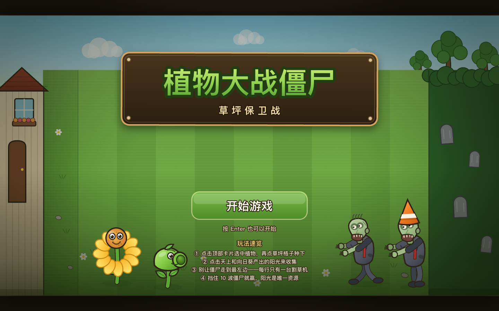
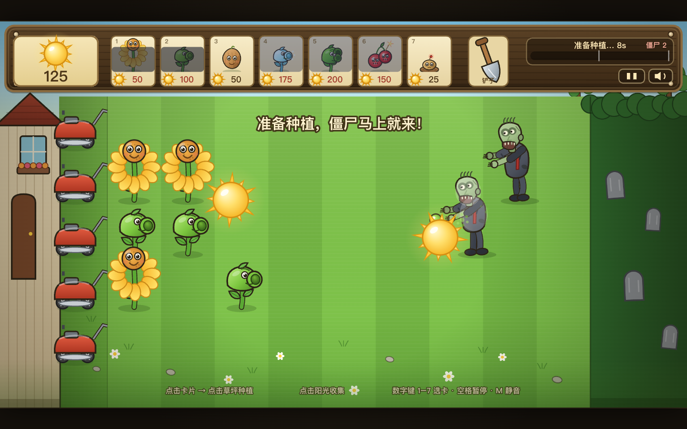
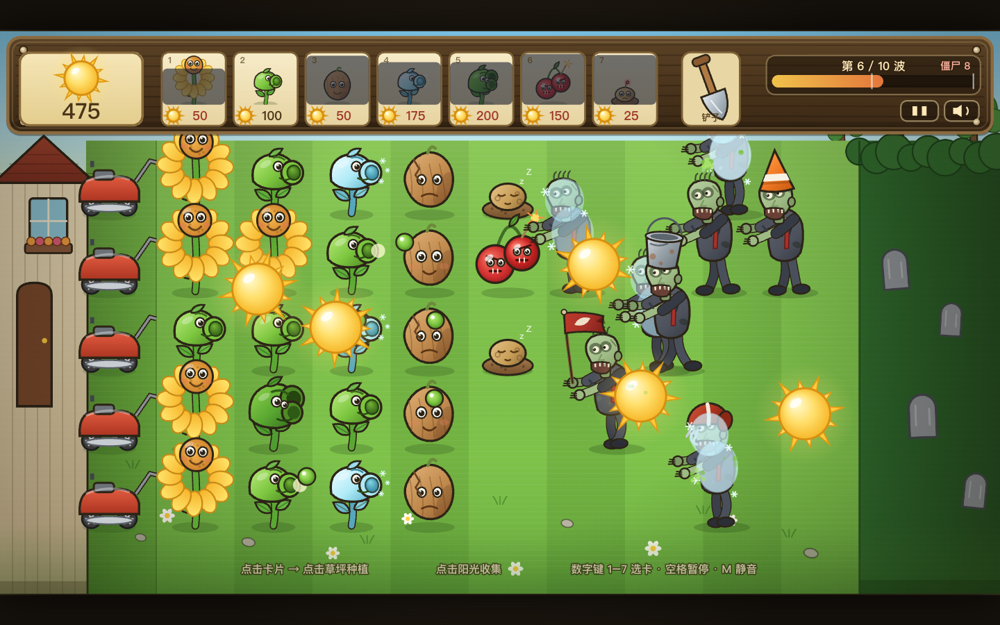

# 植物大战僵尸 · 草坪保卫战

**▶ 在线试玩：[cyancat22.github.io/plants-vs-zombies](https://cyancat22.github.io/plants-vs-zombies/)** ｜ [GitHub 仓库](https://github.com/CyanCat22/plants-vs-zombies)

一个可以直接在浏览器里玩的《植物大战僵尸》风格塔防小游戏：种向日葵攒阳光，用豌豆、寒冰、坚果和炸弹挡住 10 波僵尸，守住你的脑子。**一局约 10 分钟，有输有赢，越到后面越紧张。**

**纯前端、零依赖、零安装**：所有画面是 Canvas 2D 实时绘制的矢量卡通，所有声音是 WebAudio 现场合成，没有一张图片、没有一个音频文件，也不需要联网。



---

## 开始游戏

- **在线直接玩**：<https://cyancat22.github.io/plants-vs-zombies/>，电脑或手机浏览器打开即可，无需安装。
- **本地玩**：双击 `index.html`（或双击 `启动游戏.command`），用 Chrome / Edge / Safari 打开即可。
- **本地服务器（可选）**：`node server.mjs`，然后访问 <http://127.0.0.1:5180>。
- 建议窗口不小于 1024×600；画面会按 16:9 等比缩放居中，窗口拉大更清楚。

## 玩法

1. 点击顶部的**植物卡片**选中植物，再点击草坪格子把它种下。
2. 点击天上掉落和向日葵产出的**阳光**来收集，阳光是唯一货币。
3. 僵尸从右侧进场，啃掉植物后继续向左走；**每行只有一台割草机**，用完就没了。
4. 挡住 **10 波**僵尸即可通关；任何一只僵尸走到房子前，游戏失败。




## 操作

| 操作 | 鼠标 / 触屏 | 键盘 |
|---|---|---|
| 选卡 | 点击卡片 | `1`–`7` |
| 种植 | 选中后点击草坪格子 | — |
| 收集阳光 | 点击阳光 | — |
| 铲除植物 | 点铲子 → 点植物 | `S` 切换铲子 |
| 取消选择 | 右键 / 点空地 | `Esc` |
| 暂停 / 继续 | 点右上角暂停按钮 | `空格` / `P` / `Esc` |
| 静音 | 点右上角喇叭按钮 | `M` |
| 重开一局 | 结束界面按钮 | `R` |
| 开始游戏 | 点「开始游戏」 | `Enter` / `空格` |

## 植物图鉴

| 植物 | 阳光 | 作用 |
|---|---|---|
| 🌻 向日葵 | 50 | 每 23 秒产出 25 阳光，经济基础 |
| 🌱 豌豆射手 | 100 | 向本行发射豌豆，20 伤害 / 1.4 秒 |
| 🥜 坚果墙 | 50 | 4000 生命，替后排争取时间 |
| ❄️ 寒冰射手 | 175 | 冰豌豆造成伤害并减速 50%，持续 3.2 秒 |
| 🌿 双发射手 | 200 | 一次打两颗豌豆，火力翻倍 |
| 🍒 樱桃炸弹 | 150 | 引线 1.15 秒后炸飞周围 3×3 僵尸，1800 伤害 |
| 🥔 土豆地雷 | 25 | 埋伏 11 秒后武装，踩中即爆 |

## 僵尸图鉴

| 僵尸 | 生命 | 特点 |
|---|---|---|
| 普通僵尸 | 200 | 基础单位，走得慢 |
| 路障僵尸 | 560 | 头顶路障，抗打 |
| 铁桶僵尸 | 1100 | 铁桶护头，血量厚 |
| 旗帜僵尸 | 250 | 跑得快，大波僵尸的领队 |
| 橄榄球僵尸 | 1400 | 又肉又快，后期主力 |

> 铁桶、路障、橄榄球僵尸受伤后装备会破损，坚果墙会随血量出现裂纹，寒冰豌豆会留下冰霜——都是实时的血量表现。

## 实现要点

- **画面**：Canvas 2D 手绘矢量风格，7 种植物 / 5 种僵尸各有行走、啃食、受击、倒地动画；草坪条纹、木纹 HUD、墓地树篱、房屋窗台全部代码绘制。
- **声音**：19 种 WebAudio 合成音效（射豌豆、冰冻、咀嚼、爆炸、割草机、僵尸低吼、胜利号角等）+ 一首小调循环 BGM；支持静音、页面隐藏自动静音、触发限流防爆音。
- **游戏性**：阳光经济、卡片冷却、逐波刷怪、割草机救场、寒冰减速、樱桃 3×3 范围伤害、土豆地雷埋伏、10 波特波次（含「一大波僵尸」与「最后一波」横幅）。
- **适配**：1280×720 逻辑坐标等比缩放居中，支持鼠标与触屏，窗口大小改变实时重排。
- **性能**：背景与卡片小像离线缓存为位图，满屏 19 只僵尸 + 23 株植物时仍保持 60fps（headless 软渲染下 p90 = 16.7ms）。

## 项目结构

```
plants-vs-zombies/
├── index.html              # 入口
├── style.css               # 页面与画布布局
├── js/
│   ├── config.js           # 数值表：植物 / 僵尸 / 波次 / 布局
│   ├── art.js              # 全部矢量美术（背景、植物、僵尸、特效）
│   ├── audio.js            # WebAudio 音效合成与 BGM
│   ├── game.js             # 核心引擎：阳光、种植、波次、战斗、胜负
│   ├── hud.js              # 顶部栏、卡片、波次条、开始/暂停/结算界面
│   └── main.js             # 启动、缩放、输入、主循环、调试 API
├── docs/CONTRACT.md        # 模块接口契约
├── tests/                  # 自动化测试（引擎 / 美术 / 音频 / 截图）
├── shots/                  # 截图
├── server.mjs              # 可选静态服务器
└── 启动游戏.command          # macOS 双击启动
```

## 测试

测试需要 Node 18+ 和本机 Chrome；`puppeteer-core` 已列入 devDependencies：

```bash
npm install      # 安装测试依赖（游戏本身零依赖）
npm run check    # 全部 JS 语法检查
npm test         # 引擎机制测试 + 整局冒烟测试
```

Chrome / puppeteer 不在默认路径时，用环境变量覆盖：

```bash
CHROME_PATH="/path/to/Chrome" PUPPETEER_PATH="node_modules/puppeteer-core" npm test
```

测试脚本（`tests/`）覆盖：

- `engine-check.mjs`：15 项机制断言（种植冷却、伤害、啃食、寒冰、炸弹、地雷、割草机、判负、10 波通关、重开归零）
- `smoke.mjs`：真实鼠标事件路径（选卡 → 种植 → 收集阳光 → 暂停 → 胜负界面）
- `art-analyze.mjs`：逐个精灵的包围盒 / 颜色丰富度 / 描边占比 / 原点校验
- `audio-check.mjs`：19 个音效、静音、限流、BGM、无 WebAudio 降级（62 项断言）
- `shots.mjs`：生成 README 截图
- `visual-check.py`：截图尺寸、配色与渲染完整性检查（需要 Python + Pillow）
- `qa-func.mjs` / `qa-visual.mjs` / `qa-autoplay.mjs`：独立 QA 的功能、视觉与自动对局测试
- `_puppeteer.mjs`：测试共用入口，自动定位 `puppeteer-core` 与 Chrome

QA 报告见 [QA-REPORT.md](QA-REPORT.md)：独立黑盒 QA 共 **74 项功能用例 + 51 项视觉用例全部通过**，4 种窗口尺寸的点击映射全部正确，控制台零报错；自动对局机器人 4 局 3 胜（每局消耗 2–5 台割草机），难度「能赢但不轻松」。

## 在线版与部署

仓库根目录就是可部署的静态站点，**没有构建步骤**。GitHub Pages 设置为「Deploy from a branch → `main` / `(root)`」即可，push 后自动重建：

- 在线地址：<https://cyancat22.github.io/plants-vs-zombies/>
- 页面内所有路径均为相对路径，部署在任意子路径下都能正常运行
- `.nojekyll` 用于跳过 Jekyll 处理，加快构建
- 如需绑定自定义域名，在 Pages 设置里填 CNAME 即可

## 已知边界

- 单一关卡（白天前院 10 波），没有商店、图鉴、存档与多场景；胜负后可直接重开。
- 音效为主观合成音色，没有真人配乐；如需调整可在 `js/audio.js` 顶部改音量常量。
- 推荐 Chrome / Edge / Safari 最新版；非常老的浏览器可能不支持 `roundRect` 等 API。

---

用到的技术：HTML5 Canvas、Web Audio API、Pointer Events、`requestAnimationFrame`，无第三方运行时依赖。